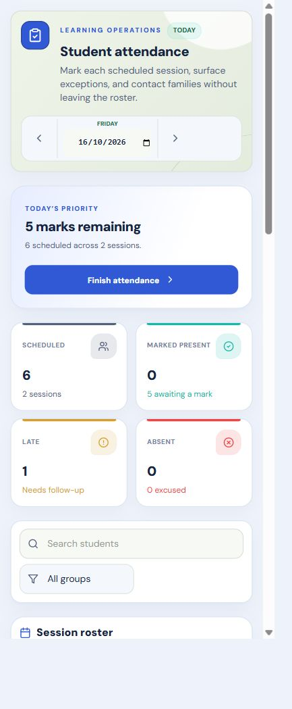
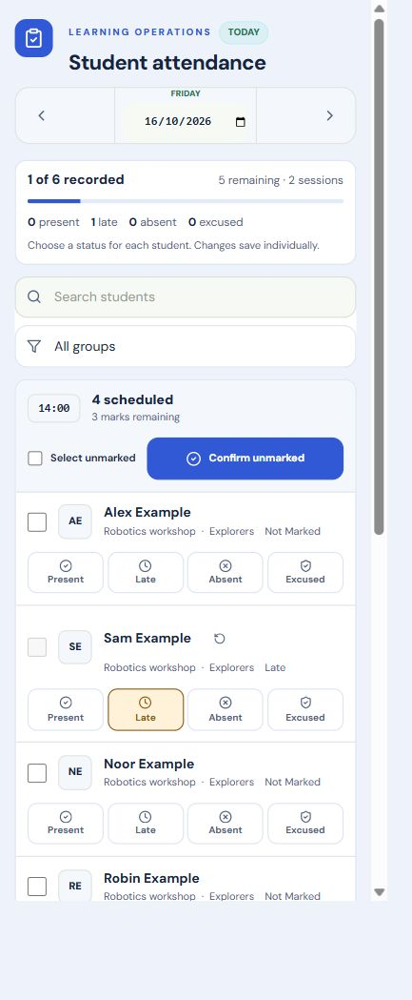
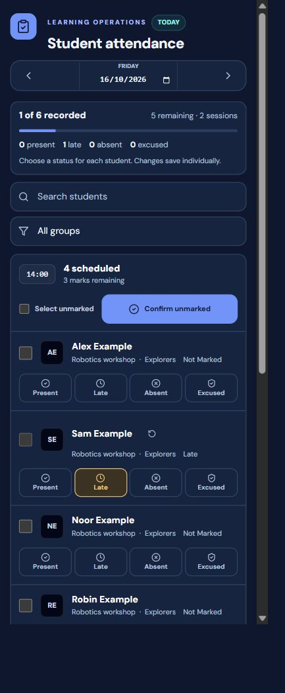

# Edufy Pulse — Attendance milestone

Local candidate, 2026-10-16. Branch `agent/edufy-pulse-attendance-20261016`, based on `1412bb7`. Discovery: `b0e069f`; compatible foundations: `06cce12`; implementation follows in its own commit. No push, merge or deployment.

## Findings and design

The previous screen placed a large command header, priority panel, four metric cards and membership-renewal rows ahead of the marking roster. The existing Education/Atlas component and token owners already provide the right migration base; a second UI library was unnecessary.

Pulse retains the approved blue identity, DM Sans interface typography, tabular figures, light default and dark option. Color identifies actions and attendance states. The working register is the main surface, with a compact persistent daily progress strip. Secondary renewal work is disclosed below the register and linked from the progress area when relevant.

## Implementation

| Owner | Change |
| --- | --- |
| `components/education-ui/education-ui-v1.css` | Added semantic warning/soft-status, control and motion tokens in both themes; opt-in compact operational header styling. Existing token values and default consumers retained. |
| `components/atlas/AtlasSurface.tsx` | Optional `density` prop on the existing command header; default layout retained. |
| `views/AbsenceView.tsx` | Compact date/context, count-backed progress, immediate search/group filters and session roster, neutral status controls, accessible per-student groups, pending/saved/error feedback, renewal disclosure and existing destination actions. |
| `views/school-day/education-attendance-pulse.css` | Named module styles, 44px touch controls, responsive rows, both themes. Overrides are restricted to Attendance because the existing compatibility bridge contains important utility rules. |
| `context/AppContext.tsx` | Two additive Attendance readiness fields on the existing tenant listener. Metadata events distinguish a cached initial snapshot from the first server snapshot. The overall workspace startup gate is unchanged; no duplicate query. Public demo retains its existing empty behavior. |
| `scripts/preview-pulse-attendance.mjs`, `scripts/fixtures/pulse-attendance*.jsx` | Isolated localhost browser harness for the actual view, a historical baseline, and the actual AppProvider with synthetic Firebase adapters. Never imported by the application entry point. |

All existing attendance record IDs, payloads, timestamps, eligibility selectors, schedules, confirmation dialogs, batch size and selected/unmarked filtering remain. UI submission serialization prevents conflicting local requests. The affected rows retain their previous displayed statuses until the existing write promise resolves; acknowledged batch chunks can advance independently. Saved feedback is issued after successful acknowledgement. This is a display safeguard for operations in the mounted screen, not a replacement persistence layer.

No authentication, authorization, backend API, Firestore rule/index, schema, payment calculation, financial workflow or production record changed. Search, group filters, date navigation, selection, marking, clear-mark, batch confirmation, family-message entry and renewal profile navigation remain available. `?ui=atlas-legacy` remains the presentation fallback; the loading and save safeguards also protect that view.

## Visual comparison

Same six synthetic students, same styling context, same browser. Measurements are the register's top offset in the isolated module harness, not a timing benchmark or the full production shell. No horizontal overflow at the checked widths; mark controls measure approximately 44 CSS px high.

| CSS width | Light before → after | Dark before → after |
| --- | --- | --- |
| 1440 desktop | 559 → 278 px | 572 → 278 px |
| 766 tablet | 776 → 278 px | 797 → 278 px |
| 390 phone | 912 → 397 px | 918 → 384 px |

### Phone, light — before

### Phone, light — after

### Phone, dark — after

Desktop and tablet before/after captures in both themes are in `pulse-evidence/`.

## Verification actually run

- Production build passes; existing large-chunk and Firebase import warnings remain. No dependency added.
- Repository `tsc --noEmit`: 235 existing diagnostics at baseline and after implementation; the complete diagnostic outputs match. No new diagnostic in Attendance, AtlasSurface or the new readiness fields.
- `node scripts/test-membership-lifecycle.mjs`: coverage, attendance eligibility, renewals and school-cohort checks pass.
- `node scripts/atlas-loop-agent.js`: context-reader runs. No dedicated agent-check, npm lint or npm test command is configured.
- Browser on the actual Attendance component: search, group filtering, empty-filter recovery, no-session destination, future-date lock (24 disabled mark controls), keyboard focus, individual save wait/success/failure, clearing a mark, selected batch and full session batch. An existing late mark survives both batches. Completion appears only after the final acknowledgement.
- Actual AppProvider with mocked Firebase callbacks: cached empty snapshot keeps Attendance in Loading; server snapshot opens the populated roster; permission-denied callback replaces controls with an error; Reload returns to loading. Other workspace startup subscriptions keep their existing order.
- Renewal disclosure opens and retains the existing student-details destination. Empty schedule retains Open classes.
- Browser console: existing Tailwind CDN warning and deliberately injected synthetic save/read errors; no unexpected application exception observed.
- New selected-status token pairs were contrast-checked. Dark excused text uses `--edu-info`, after the initial brand-on-soft pair measured below 4.5:1. This is not a claim of a complete WCAG audit.
- `git diff --check` passes. Reduced-motion behavior remains in the existing `.edu-v1` media rule; no animation package was added.

## Unverified and risks

- Signed-in school-account marking, reload persistence, staff role restrictions and a physical-phone run remain unverified. Synthetic adapters prove frontend flow, not live Firebase authorization/persistence.
- No production record was created or edited. WhatsApp sending was not exercised. Existing multi-chunk partial-failure behavior is preserved; a >400-record batch was not browser-tested.
- A cold offline visit now waits for Attendance's first server snapshot instead of presenting cached emptiness as a markable roster. A pending write holds local controls until acknowledgement/error; no false timeout claims a queued write was cancelled.
- Other consumers still use the existing `attendanceRecords` data. The new readiness flags are consumed by Attendance only. Wider offline/cache/readiness behavior is a separate data-layer concern.
- The existing student profile can reveal `loginInfo.initialPassword`. Reported to the user and recorded as a priority security follow-up. Recommend a server-side reset/invitation workflow and separate credential-retention review; no credential value was read or exposed in this audit.
- The previously recorded Windows Public-network/firewall block still prevents claiming physical-phone LAN acceptance. Local application preview at port 5202 returns HTTP 200.

## Reproduce and next boundary

Run `node scripts/preview-pulse-attendance.mjs` for synthetic view QA on `127.0.0.1:5231`, `--baseline` for original Attendance from `1412bb7` on port 5232, or `--provider` for real-provider/readiness QA on port 5233. Query options: `theme=dark`, `scenario=empty`, `scenario=renewal`, `scenario=loading`, `scenario=error`. These bind to localhost only. Restart after editing source.

The actual application continues to use its original live hooks and services. The first Pulse milestone is locally implemented. Stop here for the phase report; the next gate is designated school-account acceptance, followed by Classes, Students and Student Profile in that order. Release requires separate authorization.
